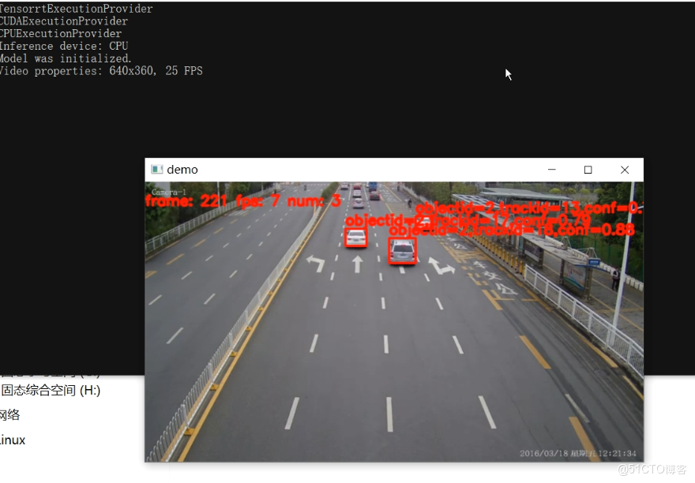

# [cmake] C++ Usage of Yolo26 Object Detection to Combine with ByteTrack for Object Tracking

[Introduction]Implementing YOLO26 object detection and ByteTrack's multi-object tracking in C++ is a relatively complex process, involving deep learning.

[Introduction]

Implementing YOLO26 object detection and multi-object tracking with ByteTrack in C++ is a relatively complex process, involving multiple fields such as deep learning, computer vision, and real-time data processing. Below, I will briefly introduce these two technologies and outline how they can be implemented in C++.

YOLO26 (You Only Look Once, version 26) is a real-time object detection algorithm that achieves efficient object detection by simultaneously predicting the location and category of all targets within a single network. YOLO26 strikes a good balance between speed and accuracy, making it the preferred method for many real-time applications.

ByteTrack is a multi-target tracking algorithm that integrates the steps of target detection and tracking. ByteTrack employs a target detection algorithm (such as YOLOv8) to identify targets in video frames, and a tracking algorithm to track their movements between consecutive frames. ByteTrack achieves multi-target tracking by correlating targets across adjacent frames, thus accurately tracking the trajectories of multiple targets.

Implement the combination of YOLO26 and ByteTrack in C++, the following steps are needed:

1. **Load YOLOv26 model**

Firstly, you need to load the pre-trained YOLOv26 model. This can be achieved by using a deep learning framework (such as TensorFlow, PyTorch, or ONNX Runtime). You need to convert the model into a format that C++ can understand and load it in your program.

1. **Processing video frames**

Then, you need to read frames from video files or capture real-time frames from the camera. These frames will be fed into the YOLO26 model for object detection.

1. **Executing Object Detection**

After loading the model, you can feed each frame into the model for object detection. The model will return bounding boxes and categories for each detected object.

1. **Multi-object tracking**

Next, you can use the ByteTrack algorithm to track these targets. ByteTrack will associate the targets based on their positions and motion information in adjacent frames, thus tracking their trajectories.

1. **Display Results**

Finally, you can visualize the tracking results and display them on the screen. This can be achieved by drawing bounding boxes and track lines on the original video frames.

It is important to note that the implementation of this process requires a certain level of computer vision and deep learning foundations, as well as familiarity with C++ programming. Additionally, since YOLO26 and ByteTrack are relatively new technologies, it may be necessary to use more advanced deep learning frameworks and libraries for support.

Overall, implementing multi-object tracking for YOLO26 and ByteTrack in C++ is a challenging task, but it provides powerful tools for real-time object detection and tracking. Through continuous learning and practice, you can gradually master these technologies and apply them to various practical applications.

[Effect Display]



[Operating Steps]

Preparation of the environment in advance: one Windows x64 machine with Visual Studio 2019 or Visual Studio 2022, CMake 3.30.1, ONNXRuntime 1.20.1 (GPU requires installation of CUDA and corresponding version libraries), OpenCV == 4.9.0, VSCode.

Step 1: First, install OpenCV 4.9.0, ONNX Runtime 1.20.1, and Visual Studio 2019 or Visual Studio 2022, along with CMake = 3.30.1.

[Code Invocation]

-
-
-
-
-
-
-
-
-
-
-
-
-
-
-
-
-
-
-
-
-
-
-
-
-
-
-
-
-
-
-
-
-
-
-
-
-
-
-
-
-
-
-
-
-
-
-
-
-
-
-
-
-
-
-
-
-
-
-
-
-
-
-
-
-
-
-
-
-
-
-
-
-
-
-
-
-
-
-
-
-
-
-
-
-
-
-
-
-
-
-
-
-
-
-
-
-
-
-
-

```
#include <iostream>#include <opencv2/opencv.hpp>#include "Yolo26Manager.h"#include "cmdline.h"#include "ByteTrack/BYTETracker.h"#include "ByteTrack/Object.h"using namespace std;using namespace cv;
Scalar get_color(int track_id){int hue = track_id * 180 % 180;Mat hsv(1, 1, CV_8UC3, Scalar(hue, 255, 255));	Mat rgb;cvtColor(hsv, rgb, COLOR_HSV2BGR);return Scalar(rgb.at<Vec3b>(0, 0)[0], rgb.at<Vec3b>(0, 0)[1], rgb.at<Vec3b>(0, 0)[2]);}
int main(int argc, char *argv[]){const float confThreshold = 0.3f;const float iouThreshold = 0.4f;
bool isGPU = false;const std::string modelPath = "yolo26n.onnx";// Initialize the YOLO detectorYolo26Manager detector(modelPath, isGPU);
	std::cout << "Model was initialized." << std::endl;	std::vector<Detection> result;cv::VideoCapture cap("car.mp4");
// Get video propertiesint img_w = static_cast<int>(cap.get(cv::CAP_PROP_FRAME_WIDTH));int img_h = static_cast<int>(cap.get(cv::CAP_PROP_FRAME_HEIGHT));int fps = static_cast<int>(cap.get(cv::CAP_PROP_FPS));	std::cout << "Video properties: " << img_w << "x" << img_h << ", " << fps << " FPS" << std::endl;
long nFrame = static_cast<long>(cap.get(cv::CAP_PROP_FRAME_COUNT));if (!cap.isOpened())	{		std::cout << "open capture failured!" << std::endl;return -1;	}	Mat frame;byte_track::BYTETracker tracker(fps, 30);int num_frames = 0;int keyvalue = 0;int total_ms = 1;while (true)	{		cap.read(frame);if (frame.empty())		{			std::cout << "read to end" << std::endl;break;		}		num_frames++;auto start = std::chrono::system_clock::now();		result.clear();// Detect objects in the frame		result = detector.Inference(frame);// Draw bounding boxes on the frame// detector.DrawImage(frame, result); // Uncomment for mask drawing
		std::vector<byte_track::Object> objects;for (const auto &det : result)		{			objects.emplace_back(byte_track::Rect<float>(det.bbox.x, det.bbox.y, det.bbox.width, det.bbox.height),								 det.class_id, det.confidence);		}		std::vector<std::shared_ptr<byte_track::STrack>> output_stracks = tracker.update(objects);auto end = chrono::system_clock::now();		total_ms = total_ms + static_cast<int>(std::chrono::duration_cast<chrono::microseconds>(end - start).count());for (size_t i = 0; i < output_stracks.size(); i++)		{const byte_track::Rect<float> &rect = output_stracks[i]->getRect();bool vertical = rect.width() / rect.height() > 1.6f;if (rect.width() * rect.height() > 20.0f && !vertical)			{				Scalar s = get_color(static_cast<int>(output_stracks[i]->getTrackId()));putText(frame, format("objectid=%zu,trackid=%zu,conf=%.2f", output_stracks[i]->getObjId(), output_stracks[i]->getTrackId(), output_stracks[i]->getScore()), Point(static_cast<int>(rect.x()), static_cast<int>(rect.y() - 5)),0, 0.6, Scalar(0, 0, 255), 2, LINE_AA);				cv::rectangle(frame, cv::Rect(static_cast<int>(rect.x()), static_cast<int>(rect.y()), static_cast<int>(rect.width()), static_cast<int>(rect.height())), s, 2);			}		}		cv::putText(frame, format("frame: %d fps: %d num: %zu", num_frames, num_frames * 1000000 / total_ms, output_stracks.size()),Point(0, 30), 0, 0.6, cv::Scalar(0, 0, 255), 2, cv::LINE_AA);
		cv::imshow("demo", frame);		keyvalue = cv::waitKey(1);if (keyvalue == 113 || keyvalue == 81)		{break;		}	}	cap.release();
return 0;}
```

```
```


## Payment

Here is a pay link on Stripe ( https://buy.stripe.com/3cs8yP7sY87d0vu9AB ). Please contact me lonlonago@foxmail.com after funding $89, and I will send you a complete data files , thank you!


